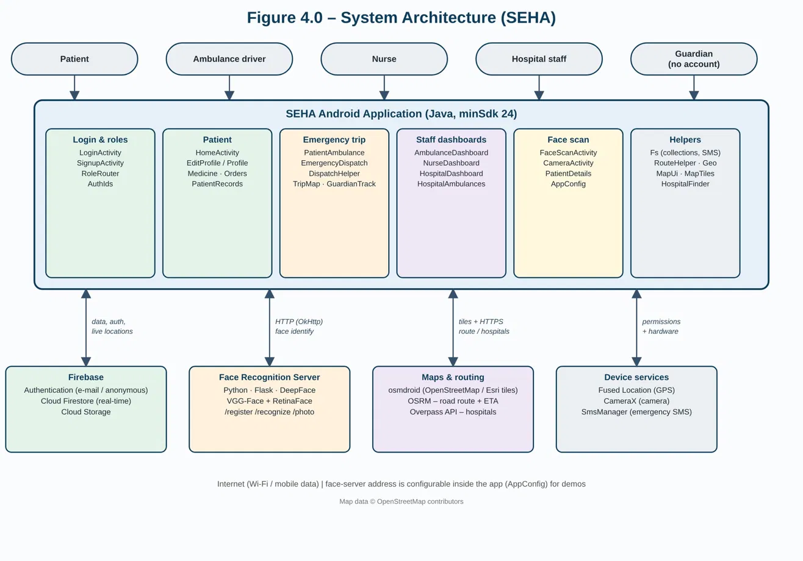
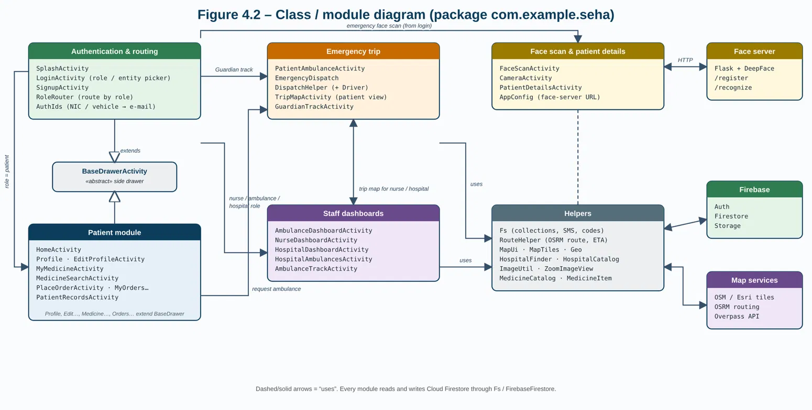
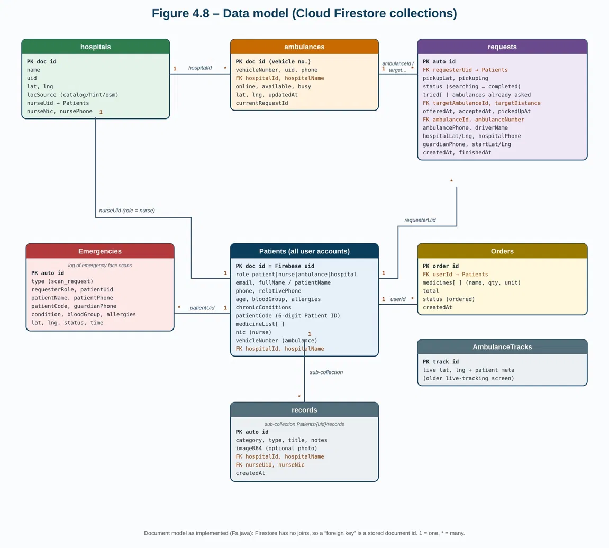
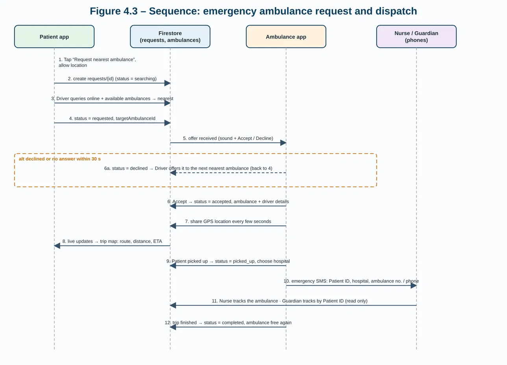
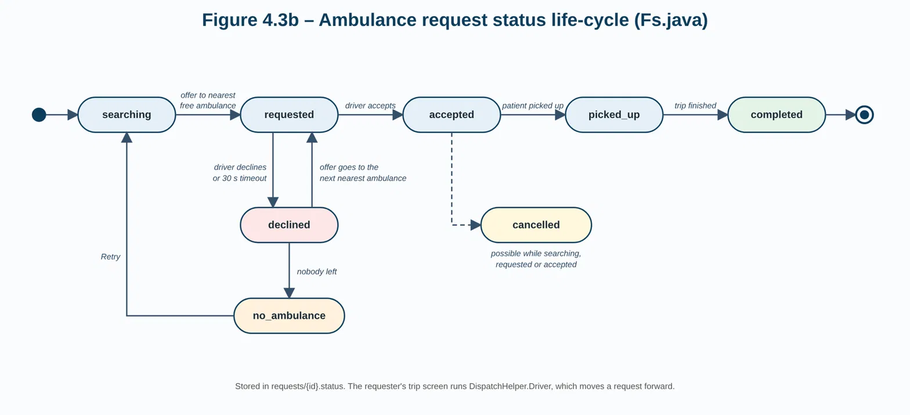
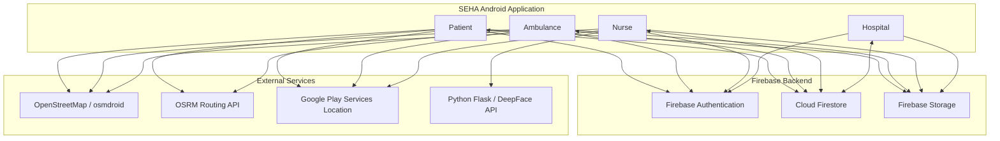

# 🏥 SEHA
### Smart Emergency & Healthcare Assistance

<p align="center">
  <strong>Connecting Patients, Ambulances, Nurses & Hospitals Through Smart Technology.</strong>
</p>

<p align="center">
  An Android-based healthcare assistance platform designed to support emergency coordination, ambulance dispatch, patient monitoring, and healthcare communication.
</p>

<p align="center">
  
  
  
  
</p>

<p align="center">
  
  
  
</p>

---

## 📌 Overview

**SEHA (Smart Emergency & Healthcare Assistance)** is an Android-based healthcare support application designed to improve communication and coordination between patients, ambulance teams, nurses, hospitals, and guardians.

The platform integrates emergency SOS alerts, ambulance dispatch, real-time GPS location sharing, patient medical records, face recognition support, and medicine ordering into a unified mobile application.

SEHA aims to demonstrate how modern mobile technologies and cloud-based services can support faster emergency coordination and improve access to essential healthcare information.

> **Project Notice:** SEHA is an academic/demo project. It is not a certified emergency response system or clinical decision-making platform and must not be relied upon as the sole means of obtaining emergency medical assistance.

---

## ✨ Core Features

### 👤 Patient Module

- Secure patient registration and authentication.
- Personalized patient profiles and emergency medical information.
- Store blood group, allergies, and medical conditions.
- SOS emergency alert with cancellation countdown.
- Live GPS location sharing during active emergencies.
- Request the nearest available ambulance.
- Monitor ambulance movement, route, estimated distance, and ETA.
- Browse available medicines and place orders.
- View medicine and order information.

### 🚑 Ambulance Module

- Authentication using registered vehicle numbers.
- Online / offline availability management.
- Receive, accept, or decline ambulance requests.
- Share live GPS location.
- Provide emergency updates to patient guardians.
- Select destination hospitals after patient pickup.
- Complete ambulance trips upon hospital arrival.

### 👩‍⚕️ Nurse Module

- Authentication using registered NIC numbers.
- View incoming ambulances assigned to the hospital.
- Track ambulances using vehicle numbers.
- Search patients using Patient ID or name.
- Access patient profiles and medical history.
- Face recognition support through the Python API.
- Add medical records, clinical notes, and images.

### 🏥 Hospital Module

- Hospital-specific authentication.
- Manage registered ambulance fleets.
- Monitor active ambulance trips.
- Access trip history.
- Receive and review emergency SOS alerts.
- View nurse information and ambulance availability.

### 👨‍👩‍👧 Guardian Module

- Track patients using Patient ID and username verification.
- View shared live patient locations.
- Monitor ambulance journeys.
- Receive emergency information through SMS where supported.

---

## 🎥 App Demonstration Video

Watch the SEHA Android application demonstration to explore its main features, user interfaces, and emergency healthcare workflows.

<p align="center">
  <a href="https://drive.google.com/file/d/1fYAKA-eHXz0uMt981xZUZHwYV8IjjxQD/view?usp=sharing">
    ▶️ **Watch SEHA App Demo Video**
  </a>
</p>

---

## 🛠️ Technology Stack

| Category | Technologies |
|:---|:---|
| Mobile Development | Java, Android SDK |
| Build System | Gradle Kotlin DSL |
| User Interface | XML, AndroidX, Material Components |
| Authentication | Firebase Authentication |
| Database | Cloud Firestore |
| Cloud Storage | Firebase Storage |
| Maps & Navigation | OpenStreetMap, osmdroid |
| Routing & ETA | OSRM |
| Location Services | Google Play Services Location |
| Camera Integration | CameraX |
| Image Loading | Glide |
| Face Recognition | Python, Flask, DeepFace, Pillow |
| Networking | OkHttp |

---

## 🏗️ Project Architecture

SEHA follows a role-based application structure where different users interact with the system through dedicated modules.

### 1. System Architecture

**Figure 4.0 – System Architecture (SEHA)**



The SEHA Android application (Java, minSdk 24) serves five user roles:

- Patient
- Ambulance driver
- Nurse
- Hospital staff
- Guardian (tracking access without a separate account)

It communicates with:

- **Firebase** — Authentication, Cloud Firestore (real-time), Cloud Storage.
- **Face Recognition Server** — Python Flask + DeepFace (`/register`, `/recognize`, `/photo`).
- **Maps & Routing** — osmdroid (OpenStreetMap / Esri tiles), OSRM (road route + ETA), Overpass API.
- **Device Services** — Fused Location (GPS), CameraX, SmsManager.

---

### 2. Class / Module Diagram

**Figure 4.2 – Class / Module Diagram (package `com.example.seha`)**



| Module | Main Components |
|:---|:---|
| Authentication & Routing | SplashActivity, LoginActivity, SignupActivity, RoleRouter, AuthIds |
| Patient Module | HomeActivity, Profile / EditProfile, MyMedicine, MedicineSearch, PlaceOrder, PatientRecords |
| Emergency Trip | PatientAmbulanceActivity, EmergencyDispatch, DispatchHelper, TripMapActivity, GuardianTrackActivity |
| Staff Dashboards | AmbulanceDashboard, NurseDashboard, HospitalDashboard, HospitalAmbulances, AmbulanceTrack |
| Face Scan & Patient Details | FaceScanActivity, CameraActivity, PatientDetailsActivity, AppConfig |
| Helpers | Fs (Firestore, SMS, codes), RouteHelper, MapUi, HospitalFinder, MedicineCatalog |
| External | Face server (Flask + DeepFace), Firebase, OSM / OSRM / Overpass |

---

### 3. Data Model (Cloud Firestore)

**Figure 4.8 – Data Model (Cloud Firestore Collections)**



| Collection | Purpose | Key Fields |
|:---|:---|:---|
| `hospitals` | Hospital registry | name, lat/lng, nurseUid, nurseNic/Phone |
| `ambulances` | Ambulance fleet | vehicleNumber, hospitalId, online/available/busy, currentRequestId |
| `requests` | Ambulance requests | requesterUid, status, targetAmbulanceId, pickup/hospital locations, timestamps |
| `Patients` | All user accounts | role, profile, medical info, patientCode, medicineList, vehicleNumber / hospitalId |
| `Emergencies` | Emergency face-scan log | type, patient details, condition, location, status |
| `Orders` | Medicine orders | userId, medicines[], total, status |
| `records` | Sub-collection under Patients | category, type, title, notes, imageB64, hospital/nurse refs |
| `AmbulanceTracks` | Live tracking (legacy) | live lat/lng + patient meta |

> Document model as implemented (`Fs.java`): Firestore has no joins, so a "foreign key" is a stored document ID. `1` = one, `*` = many.

---

### 4. Emergency Ambulance Request Sequence

**Figure 4.3 – Sequence: Emergency Ambulance Request and Dispatch**



**Happy Path:**

1. Patient taps **"Request nearest ambulance"** and allows location access.
2. App creates `requests/{id}` with `status = searching`.
3. System queries online and available ambulances to identify the nearest one.
4. Status becomes `requested` with `targetAmbulanceId`.
5. Offer received on ambulance app (sound + Accept / Decline).
6. Accept → `status = accepted` + ambulance/driver details; live GPS shared.
7. Patient sees live trip map (route, distance, ETA).
8. Patient picked up → `status = picked_up`, hospital chosen.
9. Emergency SMS sent to nurse/guardian.
10. Trip finished → `status = completed`, ambulance becomes available again.

**Alternative Path:**

Decline or no answer within 30 seconds → offer goes to the next nearest ambulance.

---

### 5. Ambulance Request Status Lifecycle

**Figure 4.3b – Ambulance Request Status Lifecycle (`Fs.java`)**



**Request Status Flow:**

```text
searching → requested → accepted → picked_up → completed
                ↓
        decline / 30s timeout
                ↓
             declined
                ↓
       next ambulance / no_ambulance
```

Cancellation is possible while the request is in `searching`, `requested`, or `accepted`.

---

### 6. High-Level Component View

The following diagram illustrates the four main application entities and their connections to the backend and external services.



---

## 📁 Repository Structure

```text
SEHA/
│
├── app/
│   └── src/main/
│       ├── java/com/example/seha/     # Android application logic
│       ├── res/                       # Layouts, drawables, resources
│       └── AndroidManifest.xml
│
├── DeepFaceServer/
│   ├── app.py
│   └── faces/
│
├── Document/
│   └── images/
│       ├── figure-4.0-system-architecture.webp
│       ├── figure-4.2-class-module-diagram.webp
│       ├── figure-4.3-sequence-emergency-dispatch.webp
│       ├── figure-4.3b-request-status-lifecycle.webp
│       └── figure-4.8-data-model.webp
│
├── firestore.rules
├── FIRESTORE_AND_DEMO_GUIDE.md
├── build.gradle.kts
├── settings.gradle.kts
└── README.md
```

---

## ⚙️ Getting Started

### Prerequisites

- Android Studio with Android SDK 36.
- JDK 11-compatible toolchain.
- A Firebase project.
- Android emulator or physical device.
- Python 3 (for the optional face recognition service).
- Internet connectivity.

### 1. Clone the Repository

```bash
git clone https://github.com/SHANALIKA/SEHA.git
cd SEHA
```

### 2. Configure Firebase

1. Open the [Firebase Console](https://console.firebase.google.com/).
2. Create a Firebase project.
3. Register an Android application with package name:

```text
com.example.seha
```

4. Download `google-services.json`.
5. Place it inside:

```text
app/google-services.json
```

6. Enable the following authentication providers:
   - Email/Password
   - Anonymous

7. Create a Cloud Firestore database.
8. Publish the project's `firestore.rules` after reviewing them.

> **Important:** The included Firestore rules are intended for academic/demo use only. Review and harden them before any non-demo data is stored.

### 3. Run the Android Application

1. Open the project root in Android Studio.
2. Allow Gradle synchronization to complete.
3. Verify Firebase configuration.
4. Select the `app` run configuration.
5. Connect a device or launch an emulator.
6. Grant the required permissions when prompted.
7. Run the application.

### 4. Build Debug APK

**Windows**

```bash
gradlew.bat assembleDebug
```

**macOS / Linux**

```bash
./gradlew assembleDebug
```

APK location:

```text
app/build/outputs/apk/debug/app-debug.apk
```

---

## 🤖 Face Recognition Server Setup

SEHA includes an optional Python-based face recognition service powered by DeepFace and Flask.

### Install Dependencies

```bash
cd DeepFaceServer
python -m venv .venv
```

**Windows**

```bash
.venv\Scripts\activate
```

**macOS / Linux**

```bash
source .venv/bin/activate
```

Install required packages:

```bash
pip install flask flask-cors deepface pillow
```

### Start the Server

```bash
python app.py
```

The server listens on port `5000`.

### Connect to the Android Application

1. Connect the computer and Android device to the same Wi-Fi network.
2. Find the computer's local network IP address.
3. Open Face Scan in the application.
4. Long-press the status text to configure the server URL:

```text
http://<COMPUTER_LAN_IP>:5000
```

Replace the placeholder with the computer's actual LAN IP address.

> **Privacy Note:** Face images are biometric personal data. Use only consented test images, secure the server and local face database, and never commit real biometric data to a public repository.

---

## 🧪 Demo Account Configuration

Create demonstration accounts using the application's Sign Up screen.

**Recommended registration sequence:**

| Step | Role | Registration |
|:---:|:---|:---|
| 01 | Hospital | Select a hospital |
| 02 | Nurse | Register under the hospital |
| 03 | Ambulance | Register vehicle and assign hospital |
| 04 | Patient | Create patient account |

### Login Identifiers

| User Role | Login Identifier |
|:---|:---|
| Patient | Email Address |
| Nurse | NIC |
| Ambulance | Vehicle Number |
| Hospital | Selected Hospital |

For complete demonstration instructions, see **[FIRESTORE_AND_DEMO_GUIDE.md](FIRESTORE_AND_DEMO_GUIDE.md)**.

---

## 🔐 Permissions

The application requests the following Android permissions:

- Internet connectivity.
- Network state.
- Fine and coarse location.
- Camera access.
- SMS sending.

Permission access depends on runtime approval and device capabilities.

---

## ⚠️ Implementation Limitations

- Continuous background ambulance tracking is not implemented.
- Ambulance location updates are designed around active application screens.
- Ambulances that stop sending location updates may be considered offline.
- OSRM provides routing information, with straight-line fallback estimates when routing is unavailable.
- SMS delivery depends on device support, SIM/network availability, permissions, and messaging configuration.
- Face recognition accuracy depends on image quality, lighting, detector configuration, and recognition thresholds.
- Face recognition must not be used as the sole method of patient identification.

---

## 🛡️ Security & Privacy Checklist

Before pushing the project to GitHub:

- [ ] Exclude `app/google-services.json` unless its contents and repository access policy have been reviewed.
- [ ] Never commit real patient information or medical records.
- [ ] Keep `DeepFaceServer/faces/` private.
- [ ] Use synthetic data for demonstrations.
- [ ] Review Firestore security rules.
- [ ] Never expose passwords, private keys, or service-account credentials.
- [ ] Obtain informed consent before using biometric test images.

---

## 🤝 Contributing

Contributions and improvements are welcome.

1. Fork the repository.
2. Create a feature branch.
3. Implement your changes.
4. Test the affected functionality.
5. Commit your changes without credentials or personal information.
6. Submit a Pull Request with a clear description.

---

## 📄 License

No open-source license has been specified for this repository. All rights are reserved by the respective project owner unless a license is added.

---

<p align="center">
  <strong>SEHA — Smart Emergency & Healthcare Assistance</strong>
  <br/>
  <sub>Bringing Healthcare Coordination Closer Through Technology.</sub>
  <br/><br/>
  Built as an Academic Software Engineering Project.
</p>
